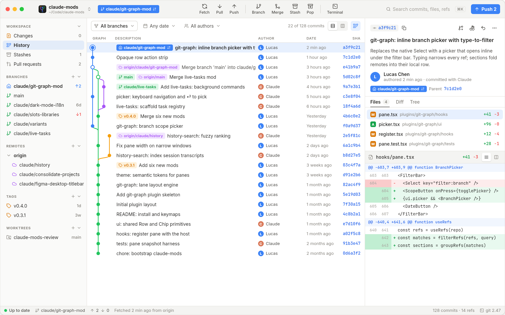

# Git Graph

A desktop commit graph for Git and GitHub: history, changes, stashes and pull requests in one window. It started as a Neovim pane and grew into an app.



## Download

Git Graph is released for macOS. Get the latest app from **[Releases](https://github.com/chenzizhen237-crypto/git-graph/releases/latest)**.

On macOS, double-click [`scripts/Update-Git-Graph.command`](scripts/Update-Git-Graph.command) to download and install the latest stable release into `/Applications`, then launch it. The standalone script selects Apple Silicon or Intel automatically, verifies the GitHub asset SHA-256 digest and app signature, and backs up the previous app under `~/Library/Application Support/Git Graph/Installer Backups`. It requires no Git, Node.js or GitHub account. It asks a running app to quit before replacing it and restores the previous app if replacement fails.

To download and validate without changing your installed app:

```bash
./scripts/Update-Git-Graph.command --prepare
```

The builds are not signed with a paid certificate yet. Right-click the app and choose **Open** the first time (or run `xattr -cr "/Applications/Git Graph.app"`). On Windows or Linux, build from source.

Pull requests use the [GitHub CLI](https://cli.github.com): run `gh auth login` once.

## Features

- **History**: lane graph of all branches with labels, filters (branch, date, author, message), commit inspector and diffs; check out, branch, tag, cherry-pick, revert.
- **Changes**: stage / unstage / discard, resolve conflicts, commit, amend, commit & push.
- **Stashes**: apply, pop, drop.
- **Pull requests** (⌘4): list, conversation, review, merge, checks, files, new PR.
- **Actions** (⌘5): workflow runs, jobs and step logs with errors highlighted; re-run failed jobs, cancel. CI status (✓ ✗ ●) beside every commit in History.
- **CI/CD** (⌘6): every repository on this Mac in one list, failing first, with the latest checks on its default and current branch, from GitHub Actions or any CI that reports to GitHub, and the latest deployment to each environment; open one straight in Actions.
- **GitHub repositories**: clone from your and your organisations' repositories, publish a local repository, fork; right-click commits, files, branches and tags to open them on GitHub or copy a permalink.
- **Diffs**: unified or side by side, wrap, ignore whitespace, pop out to full window; open files in your editor, diff tool or merge tool.
- **Your repositories**: the Welcome screen lists the repositories already in your code folders, with branch, changes and last activity.
- **Layout**: resizable panels, collapsible sidebar, overlay scrollbars.
- **Settings** (⌘,): git identity and commit signing (GPG / SSH), auto-stash, fonts and zoom, graph columns and date format, commit template and subject guide, external tools, desktop notifications (CI, new commits, updates), auto-fetch, proxy, theme, English / 简体中文.
- ⌘K palette and shortcuts throughout.

## Build from source

Needs Node 24, pnpm and Rust (plus the [Tauri prerequisites](https://tauri.app/start/prerequisites/) on Linux).

```bash
pnpm install
pnpm app                          # run in development
pnpm tauri dev -- -- ~/code/repo  # open a repository straight away
pnpm bundle                       # installers in src-tauri/target/release/bundle
pnpm check                        # typecheck, lint, format check, tests
```

## Landing

Changes reach `main` through `pnpm land <branch>`: it merges the branch onto `main`, runs `jimmy-test ci` on that merge, and pushes only if it passes. A local pre-push hook refuses other pushes to `main`. `pnpm land <branch> --override "reason"` skips the tests when Jimmy is down and records why. GitHub CI starts by hand, for a Linux or Windows pass before a release.

## Releasing

Releases are built and published locally on Jimmy's Mac mini, macOS only:

1. Bump the version in `package.json`, `src-tauri/tauri.conf.json` and `src-tauri/Cargo.toml`, write `.github/release-notes/v<version>.md`, and merge to `main`.
2. Run the release on Jimmy:

```bash
jimmy-test --ref main -- pnpm release
```

`scripts/release.sh` checks the versions and notes, runs `pnpm check`, builds the Apple Silicon app and DMG, and publishes them as the latest GitHub release with the tag `v<version>` at that commit. `pnpm release --dry-run` builds without publishing; `ARCHS="aarch64 x86_64"` adds an Intel build. The **Release** GitHub workflow is a manual fallback that builds the Mac app on GitHub's runners.

## How it's built

- **Tauri 2** (Rust) runs `git` and `gh`, watches the repository, and talks to GitHub's API over one kept-alive connection. The GitHub token comes from `gh auth token` and never reaches the web view.
- **React 19 + TypeScript**, styled with **Tailwind CSS 4**. The Tailwind theme is generated from the design file's variables (`pnpm tokens`), so utilities like `bg-sidebar` or `text-ref-head` are the design tokens.
- The design lives in [`assets/design/Git Graph Desktop.nib`](assets/design); see [assets/README.md](assets/README.md).
- **Prettier** formats, **Biome** lints, **Vitest** tests; `jimmy-test ci` runs CI, and releases are built on Jimmy's Mac mini (see Releasing).

```
assets/            design file (Nib), app icon, screens
scripts/tokens.ts  design variables → CSS / Tailwind theme
src-tauri/         Rust: git, gh, GitHub client, watcher, proxy
src/lib/           git and GitHub data, graph layout, i18n, settings
src/components/    title bar, sidebar, diff, settings, palette…
src/views/         History, Changes, Stashes, Pull requests, Welcome
```

## Keys

⌘K palette · ⌘1–5 History / Changes / Stashes / Pull requests / Actions · ⌘, settings · ⌘\ sidebar · ⌘R refresh · ⌘O switch repository · ⌘⇧F fetch · ⌘⇧P push · ↑↓ / j k move · ⌘↩ commit

## License

[MIT](LICENSE)
